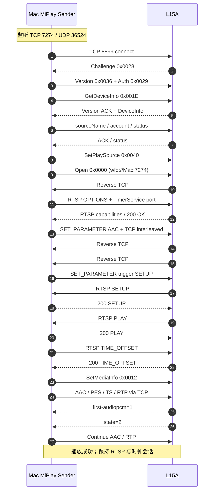
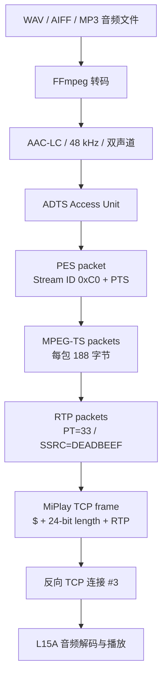
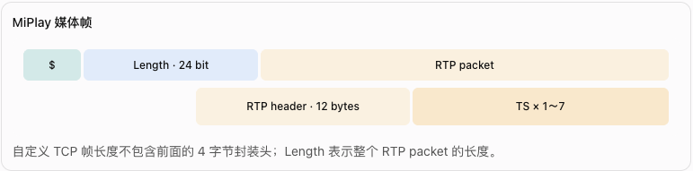

# 小米 AI 音箱 2（L15A）原厂固件本地 MiPlay 音频播放方案

V14 实机播放验证通过

## 一、项目结论与验证环境

经过 V1～V14 多轮协议分析、代码实现和 PCAP 抓包验证，已经实现：

Mac mini → 局域网 MiPlay 协议 → 小米 AI 音箱 2（L15A）播放自定义音频文件。

不需要刷机、Root 音箱或更换原厂固件，也不依赖云端 TTS 播放接口。

### 1. 已验证的环境

| 项目         | 配置                        |
| ---------- | ------------------------- |
| 音箱         | 小米 AI 音箱 2，型号 L15A        |
| 固件         | `1.92.16`                 |
| 设备标识       | `xiaomi.wifispeaker.l15a` |
| 发送端        | Mac mini，Apple Silicon    |
| macOS      | 26.6.2                    |
| 发送端 IP     | `192.168.3.18`            |
| 音箱 IP      | `192.168.3.4`             |
| 控制协议       | MiPlay Legacy，TCP 8899    |
| RTSP 与媒体端口 | TCP 7274                  |
| 时钟同步       | UDP 36524                 |
| 音频         | AAC-LC，48 kHz，双声道         |
| 已验证版本      | `miplay_client_v14.py`    |

### 2. 方案定位

这里的关键是：Mac mini 充当 MiPlay 音频发送端（Source），小米音箱是接收端（Receiver）。不能把实现小米接收器的开源代码直接当成发送端使用。

### 3. 成功运行证据

2026 年 10 月 21 日 09:32 的 V14 运行日志显示，整条链路顺利完成：

```
09:32:56.166  TX SetPlaySource
09:32:56.166  TX Open
09:32:56.866  RTSP RX PLAY
09:32:56.931  TIME_OFFSET acknowledged
09:32:56.931  TX SetMediaInfo seq=15
09:32:57.213  receiver readiness: first-audiopcm=1
09:32:57.218  receiver readiness: state=2
09:32:57.223  AUDIO receiver readiness confirmed
09:33:01.545  AUDIO sent 216 AAC access units
```

我还核对了成功时的 `l15a-v14-media(1).pcap`，重组出如下媒体结果：

| 媒体指标                | 抓包实测         |
| ------------------- | ------------ |
| TCP 媒体负载            | 192,336 字节   |
| MiPlay/RTP 帧        | 224 帧        |
| 完整 AAC Access Units | 216 个        |
| 首个 RTP 时间戳          | `3767220630` |
| 首个 PES PTS          | `3767220630` |
| 首个 PCR base         | `8062202057` |
| RTP Marker=1        | 216 帧        |
| RTP Marker=0        | 8 帧          |

RTP 是 32 位时间戳，PCR base 是 33 位时间戳，因此两者不能仅比较原始十进制数值，需要考虑回绕和实际采样时间。

这些抓包结果与音箱实际出声的验证相吻合。

## 二、完整协议架构与网络交互

### 1. 三条协议通道

V14 实际涉及三种通信角色。

| 通道               | 连接方向                             | 功能                             |
| ---------------- | -------------------------------- | ------------------------------ |
| MiPlay 控制        | Mac → L15A:8899                  | 认证、设备查询、Open、SetMediaInfo、状态通知 |
| RTSP / WFD       | L15A → Mac:7274                  | 能力协商、SETUP、PLAY、TIME\_OFFSET   |
| UDP TimerService | L15A → Mac:36524                 | 同步发送端和接收端的单调时间                 |
| RTP 媒体           | L15A 建立 TCP → Mac:7274；Mac 写入该连接 | 传输 AAC/MPEG-TS 音频              |

特别注意：音频 TCP 连接由音箱主动连向 Mac，但实际音频字节由 Mac 发送给音箱。

### 2. 三条反向 TCP 连接的用途

音箱收到 `Open` 后，会主动连接发送端的 TCP 7274。

| 建立顺序          | 作用                  |
| ------------- | ------------------- |
| Connection #1 | RTSP 控制会话           |
| Connection #2 | 辅助连接，V14 保持打开但不发送音频 |
| Connection #3 | 音频传输连接，发送自定义 RTP 帧  |

成功抓包中的实际连接如下：

```
L15A 192.168.3.4:55690 → Mac 192.168.3.18:7274
     #1 RTSP

L15A 192.168.3.4:55694 → Mac 192.168.3.18:7274
     #2 Auxiliary

L15A 192.168.3.4:55696 → Mac 192.168.3.18:7274
     #3 RTP Media
```

不能简单认为所有连接到 TCP 7274 的流量都属于 RTSP，也不能把音频发送到第一条连接。

### 3. 完整建链时序



上图把 UDP 时钟同步的细节省略在 RTSP 阶段中。实际上，在 RTSP 会话建立后，音箱已经开始周期性发送 40 字节 UDP 时钟请求。

## 三、V14 核心协议逻辑

### 1. TCP 8899：Legacy 控制帧

MiPlay Legacy 使用自定义二进制帧：

<br />

V14 的编码实现：

```

def frame(cmd, seq, payload=b""):
    return (
        b"$"
        + struct.pack(">HHI", cmd, seq, len(payload))
        + payload
    )

```

主要控制命令：

| Command             | V14 用途             |
| ------------------- | ------------------ |
| `0x0028`            | 音箱发送 Challenge     |
| `0x0036`            | 客户端版本              |
| `0x0029`            | Legacy HMAC 认证     |
| `0x001E`            | GetDeviceInfo      |
| `0x001F`            | DeviceInfo 响应      |
| `0x0058` / `0x0059` | 设置源信息 / ACK        |
| `0x0034` / `0x0035` | 查询 MirrorMode / 响应 |
| `0x001A` / `0x001B` | Heartbeat / ACK    |
| `0x0040`            | SetPlaySource      |
| `0x0000`            | Open               |
| `0x0012`            | SetMediaInfo       |
| `0x0022`            | 音箱主动状态通知           |

认证过程的关键代码：

```

SOURCE_VERSION = b"1.0.1123012\x00"

def legacy_hmac(challenge):
    key = hashlib.md5(b"0.0.0.0").hexdigest().encode("ascii")
    return hmac.new(
        key,
        challenge,
        hashlib.sha1
    ).hexdigest().encode("ascii")

# challenge: 设备返回的 16/17 位 ASCII 数字
sock.sendall(frame(0x0036, 0, SOURCE_VERSION))
sock.sendall(frame(0x0029, challenge_seq, legacy_hmac(challenge)))
sock.sendall(frame(0x001E, 1))

```

这里使用的是实际 V14 实现的 Legacy 认证方式。它不应被理解为所有小米音箱、所有 MiPlay 版本都支持的通用认证方法。

### 2. Open：让音箱反向连接发送端

完成基础握手、设备信息、源身份与心跳检查后，发送：

```

SET_PLAY_SOURCE = (
    b'{"ref_channel":"controlcenter",'
    b'"ref_function":"single_room",'
    b'"ref_content":"music_wangyiyun"}'
)

sock.sendall(frame(0x0040, 13, SET_PLAY_SOURCE))

open_payload = (
    f"wfd://{bind_ip}:{rtsp_port}".encode()
    + b"?mirrorMode=1\x00"
)

sock.sendall(frame(0x0000, 14, open_payload))

```

Open Payload 示例：

```
wfd://192.168.3.18:7274?mirrorMode=1\0
```

音箱收到后，不是让 Mac 主动去连接音箱上的 RTSP 服务，而是音箱主动回连 Mac 的 RTSP 监听端口。

因此，监听服务必须在 `Open` 之前已经启动。

### 3. RTSP：能力协商与播放会话

V14 按以下顺序协商：

关键音频协商字段：

```
wfd_audio_codecs: AAC 00000001 00
wfd_client_rtp_ports: RTP/AVP/TCP;interleaved mode=play
wfd_presentation_URL: rtsp://192.168.3.18/wfd1.0/streamid=0 none
```

不要将这里的 RTP/AVP/TCP 误认为标准 RTSP `$ + channel + 16-bit length` 帧。 当前 L15A 实测媒体通道使用的是独立 TCP 连接及 MiPlay 自定义的 24-bit 长度前缀。

### 4. UDP TimerService：40 字节时钟同步

发送端监听 UDP 36524，并通过 RTSP `OPTIONS` 告知音箱 TimerService 地址。

V14 根据实际抓包复现 40 字节响应：

```

def handle_timer(data, peer, udp_socket):
    recv_us = time.monotonic_ns() // 1000
    send_us = time.monotonic_ns() // 1000

    out = bytearray(40)
    out[:min(40, len(data))] = data[:40]

    struct.pack_into("<Q", out, 16, send_us)
    struct.pack_into("<Q", out, 24, recv_us)

    udp_socket.sendto(out, peer)

```

响应保持原请求前 16 字节，在偏移 16、24 写入小端序 64 位微秒时间值。

UDP 时钟响应与 RTSP `TIME_OFFSET` 是相关的两个部分：前者为音箱提供时钟同步交互，后者提供本次媒体会话使用的时间偏移信息。

### 5. SetMediaInfo：使音箱进入播放状态

V10 已经完成 RTSP 和音频发送，但没有发送播放元数据。V11 补充了这一步。

```
Command = 0x0012
Sequence = 15
```

V14 使用的主要 JSON 数据如下：

```

{
  "mArtist": "Windows",
  "mAlbum": "",
  "mTitle": "System Audio",
  "mDuration": 2147483647,
  "id": "",
  "mCoverUrl": "",
  "status": 0,
  "volume": 24,
  "mArt": "",
  "mSourceName": "Mac mini",
  "mDeviceState": 2
}

```

发送 `SetMediaInfo` 后，音箱会返回以下关键通知：

```
first-audiopcm=1
state=2
```

V14 使用这两个通知判断播放就绪。在当前设备和协议环境中，这两项属于有效的就绪信号，但它们本身不等于可听音频已经输出；最终结果仍应通过实际播放验证。

## 四、AAC → MPEG-TS → RTP：V14 的媒体发送逻辑

### 1. 完整封装路径



### 2. 音频编码参数

V14 使用 FFmpeg 转码：

```
ffmpeg -hide_banner -loglevel error \
  -i /tmp/l15a-v7-test.aiff \
  -vn \
  -ac 2 \
  -ar 48000 \
  -c:a aac \
  -profile:a aac_low \
  -b:a 256k \
  -f adts \
  /tmp/l15a-test.aac
```

实际发送代码将 FFmpeg 的 ADTS 输出作为数据流读取，不需要先落盘。

| 参数         | 值                  |
| ---------- | ------------------ |
| Codec      | AAC-LC             |
| Profile    | AAC Low Complexity |
| 采样率        | 48,000 Hz          |
| 声道         | Stereo             |
| 编码目标码率     | 256 kbps           |
| AAC 每个 AU  | 1,024 个采样          |
| AU 时间      | 21.333… ms         |
| RTP 时钟     | 90,000 Hz          |
| 每 AU 时间戳步长 | 1,920 ticks        |

因此：

$\Delta PTS=\frac{1024}{48000}\times90000=1920$

### 3. MPEG-TS 结构

一个 AAC Access Unit 被组织为一个 PES，再分包到 MPEG-TS。

| PID      | 内容         |
| -------- | ---------- |
| `0x0000` | PAT        |
| `0x0100` | PMT        |
| `0x1000` | PCR 时钟包    |
| `0x1100` | AAC PES 音频 |

PAT 中声明：

```
program_number = 1
PMT PID        = 0x0100
```

PMT 中声明：

```
PCR PID          = 0x1000
stream_type      = 0x0F  (AAC)
elementary PID   = 0x1100
```

PES 音频头采用：

```
00 00 01 C0
[PES_packet_length: 2 bytes]
84 80 07
[PTS: 5 bytes]
FF FF
[AAC ADTS bytes]
```

每个 TS 包固定为 188 字节；不足一个完整 TS payload 的 PES 尾包使用 adaptation field 填充。

V14 在首个 AAC AU，以及从 AU #13 开始每间隔 5 个 AU，插入 PAT、PMT、PCR。

### 4. RTP 结构



RTP 关键参数：

```
Version       = 2
Payload Type  = 33 (MPEG-TS)
SSRC          = 0xDEADBEEF
Sequence      = 每个 RTP 包递增 1
Timestamp     = 90 kHz
Marker        = 一个 AAC AU 的最后一个 RTP 分片置 1
```

V14 核心代码：

```

for off in range(0, len(packets), 7):
    fragment = packets[off:off + 7]
    payload = b"".join(fragment)

    marker = (
        0x80 if off + len(fragment) >= len(packets)
        else 0x00
    )

    rtp = (
        bytes([0x80, marker | 33])
        + struct.pack(">HII", seq, pts, 0xDEADBEEF)
        + payload
    )

    wire = b"$" + len(rtp).to_bytes(3, "big") + rtp

    media_sock.sendall(wire)
    seq = (seq + 1) & 0xFFFF

```

成功抓包共计 224 个 RTP 帧，其中 216 个设置 Marker，另外 8 个未设置 Marker。这和 216 个 AAC AU 及少量 RTP 分片的行为相符。

## 五、最关键突破：V14 的 TIME\_OFFSET、PTS 与 PCR

这是整个调试过程中决定性的一步。

### 1. 为什么 V13 之前始终无声

V13 已经具备：

但是 V13 的发送代码仍然是：

```
pts = 0
```

与此同时，PCR 采用 Mac 的单调时钟：

```
now_us = time.monotonic_ns() // 1000pcr27 = now_us * 27
```

这造成一个问题：PES PTS/RTP Timestamp 使用从零开始的媒体时间，而 PCR 使用运行中的系统单调时间，两者没有按同一个时间域建立关系。

因此，V13 即使收到音箱 `first-audiopcm=1` 和 `state=2`，也无法保证音频会被正确调度到可听输出。

### 2. V14 修复方式

首先，RTSP 发送 `TIME_OFFSET` 时，记录对应的单调时间：

```

self.time_offset_us = time.monotonic_ns() // 1000

conn.sendall(
    rtsp(
        "TIME_OFFSET rtsp://localhost/wfd1.0 RTSP/1.0",
        [
            ("CSeq", "5"),
            ("TimeOffset", str(self.time_offset_us))
        ]
    )
)

```

然后在 RTP/PES 发送模块中，初始时间戳从同一时间域派生：

```

pts = (
    time_offset_us * 90000 // 1_000_000
) & 0xFFFFFFFF

# 每发送一个 AAC AU
pts = (pts + 1920) & 0xFFFFFFFF

```

PCR 继续使用实时单调时钟：

```

now_us = time.monotonic_ns() // 1000

pcr27 = now_us * 27

pcr_base = (
    pcr27 // 300
) & ((1 << 33) - 1)

pcr_extension = pcr27 % 300

```

这个修复把三个相关的时间量建立了联系：

$$
T_{\text{offset}} = \mathop{\mathrm{monotonic\_us}}()
$$

$$
PTS_0 = \left\lfloor \frac{T_{\text{offset}}\times90000}{10^6} \right\rfloor \bmod 2^{32}
$$

$$
PCR_{\text{27MHz}} = \mathop{\mathrm{monotonic\_us}}()\times27
$$

需要注意：V14 并不是让 PTS 和 PCR 数值完全相等。它们分别在 RTSP 发送时和媒体打包时采样，并有不同的时间戳位宽；正确做法是对齐时间域，再考虑采样间隔和回绕。

### 3. 成功抓包中的具体对照

V14 抓包实测：

```
RTSP TimeOffset = 566798454289 us

First RTP Timestamp = 3767220630
First PES PTS       = 3767220630
First PCR Base      = 8062202057
```

PCR base 是 33 位，而 RTP Timestamp 是 32 位，使用相同的 32 位模空间比较：

```
PCR Base % 2^32 = 3767234761
RTP Timestamp   = 3767220630

差值 = 14131 ticks
     ≈ 157.0 ms
```

这说明首个 PCR 与初始 RTP/PTS 已经落在可以对应的时间区间内，不再是 V13 那种从零开始、与实时 PCR 明显脱节的情况。

这里的约 157 ms 是抓包中两个采样值的差，不是已经测得的真实扬声器输出延迟。

### 4. 为什么这是最关键的修复

V13 和 V14 的验证条件基本一致，但结果不同：

| 条件               | V13 | V14  |
| ---------------- | --- | ---- |
| Open / RTSP      | 成功  | 成功   |
| SetMediaInfo     | 成功  | 成功   |
| 音箱 `state=2`     | 收到  | 收到   |
| AAC/RTP 实际发送     | 成功  | 成功   |
| 实时 PCR           | 已实现 | 已实现  |
| PTS/RTP 与时钟时间域关联 | 缺失  | 已修正  |
| 实际声音             | 无声  | 正常播放 |

基于这次单变量方向的修复和成功实验，时间戳对齐是造成此前无声的最有力根因解释。严格来说，要完成因果闭环，还可以使用 V14 分别运行“正确时间戳”和“PTS 强制从零开始”的 A/B 测试；目前不需要为了证明这一点破坏已经可用的基准版本。

## 六、V1～V14 完整调试过程复盘

整个过程可以划分为六个阶段。

| 版本    | 核心工作                                    | 测试结果与结论                                 |
| ----- | --------------------------------------- | --------------------------------------- |
| V1～V3 | 发现音箱、TCP 8899 探测、Legacy 控制帧和认证          | 验证基础通信能力                                |
| V4～V6 | Open、反向 TCP、RTSP 和 UDP TimerService     | 建立了 WFD 会话基础                            |
| V7    | 首次实现 AAC → MPEG-TS → RTP 发送             | 发送了约 192 KB 音频，但无声                      |
| V8    | 忽略 `VIDEO_LATENCY` 通知而不回复 501           | 仍然无声                                    |
| V9    | 修正 PAT 中缺失的 `program_number`，对齐 PES 可选头 | 仍然无声                                    |
| V10   | 修正 PMT PCR PID、PSI 填充、RTP Marker        | 媒体流可离线解析，仍然无声                           |
| V11   | 增加 `SetMediaInfo` 和音箱状态通知监控             | 首次明确看到 `first-audiopcm=1`、`state=2`，仍无声 |
| V12   | 中间调试实现，探索以音箱状态作为发送门控                    | 未作为独立成功基准                               |
| V13   | 增加实时 PCR 与启动音频缓冲检查                      | 216 个 AAC AU 已发送，仍无声                    |
| V14   | 使用 `TIME_OFFSET` 初始化 PTS/RTP 时间戳        | 实机出声成功                                  |

### 排障中最重要的经验

第一：TCP 连接成功不等于协议成功。

必须进一步确认 Legacy Challenge、HMAC、设备信息和播放前控制命令。

第二：RTSP PLAY 成功不等于音频已经播放。

还需要完成 SetMediaInfo、时钟同步和媒体投递。

第三：FFmpeg 能解码 MPEG-TS，不代表音箱会发出声音。

FFmpeg 可以检查 AAC/PES/TS 是否有效，但不会替音箱验证其特有的 RTP 调度、时间戳同步及播放状态机。

第四：`first-audiopcm=1` 和 `state=2` 不是可听输出的充分条件。

V13 已经收到这两项通知，实际仍然无声。

第五：对于实时音视频协议，时间轴与媒体格式同样重要。

V14 的成功证明，媒体时间戳不能与会话时钟脱离关系。

## 七、从零复现与验证步骤

### 1. 安装依赖

Mac mini 上执行：

```
brew install python ffmpeg wireshark
```

其中 Python 标准库实现了 V14 的网络协议部分，FFmpeg 负责音频转码；Wireshark 用于分析抓包。

确认环境：

```
python3 --version
ffmpeg -version
ffprobe -version
```

### 2. 测试音频

```
say -v Ting-Ting \
  -o /tmp/l15a-v7-test.aiff \
  "第二句。第三句。第四句。第五句。第六句。"
```

### 3. 验证音频输入

```
afplay /tmp/l15a-v7-test.aiff
```

再检查格式：

```
ffprobe -v error \
  -show_entries format=duration \
  -show_entries stream=codec_name,sample_rate,channels \
  -of json \
  /tmp/l15a-v7-test.aiff
```

`afplay` 用于验证音频内容能否在 Mac 本地播放；它不能证明 MiPlay 发送链路正确。

### 4. 检查网络与端口

获取 Mac 通往音箱使用的网络接口：

```
route -n get 192.168.3.4
```

检查音箱 8899：

```
nc -vz -G 3 192.168.3.4 8899
```

检查本地监听端口是否被其他服务占用：

```
lsof -nP -iTCP:7274
lsof -nP -iUDP:36524
```

注意：7274 是发送端的监听端口，不应该用 `nc 192.168.3.4 7274` 判断音箱是否可用。

### 5. 第一次运行：只进行安全探测

```
python3 miplay_client_v14.py
```

默认 Dry Run 不会连接音箱。

仅做设备连接和基础状态查询：

```
python3 miplay_client_v14.py \
  --connect \
  --confirm-host 192.168.3.4 \
  --hold 5
```

### 6. 开始真实音频播放

```
python3 miplay_client_v14.py \
  --connect \
  --confirm-host 192.168.3.4 \
  --trigger-open \
  --audio-file /tmp/l15a-v7-test.aiff \
  --hold 60 \
  2>&1 | tee l15a-v14.log
```

V14 固定验证 `192.168.3.4:8899`，如果要移植到其他设备，需要调整代码中的目标检查及发送端绑定地址。

### 7. 同时抓取 PCAP

启动抓包前，先确定接口名称：

```
IFACE=$(route -n get 192.168.3.4 \
  | awk '/interface:/{print $2; exit}')

echo "$IFACE"
```

抓取完整会话：

```
sudo tcpdump -i "$IFACE" \
  -nn -s 0 -U \
  -w l15a-v14-media.pcap \
  'host 192.168.3.4 and (tcp port 8899 or tcp port 7274 or udp port 36524)'
```

播放结束后停止抓包。这样可以同时获取控制、RTSP、音频和时钟同步流量。

### 8. Wireshark / tshark 排障

显示 TCP 会话：

```
tshark -r l15a-v14-media.pcap \
  -q -z conv,tcp
```

提取 RTSP 通道中的关键请求：

```
tshark -r l15a-v14-media.pcap \
  -Y 'tcp.port == 7274' \
  -T fields \
  -e frame.time_relative \
  -e ip.src \
  -e tcp.srcport \
  -e ip.dst \
  -e tcp.dstport \
  -e tcp.len
```

从中区分第一条 RTSP 连接、第二条辅助连接和第三条媒体连接。

媒体 TCP Stream 的 payload 需要按自定义 `$ + 24-bit Length + RTP` 解析，而不能直接按标准 RTSP interleaved frame 解释。

### 9. 常见问题定位表

| 现象                     | 优先检查                               |
| ---------------------- | ---------------------------------- |
| TCP 8899 连接失败          | 音箱 IP、局域网路由、防火墙                    |
| 收到 Challenge 但认证失败     | HMAC 输入、序列号、帧字节序                   |
| Open 后没有反向连接           | `wfd://` 地址、Mac 监听端口、防火墙           |
| 有 RTSP 但没有 PLAY        | AAC 能力协商、SETUP、Session 与 Transport |
| 没有 UDP TimerService 请求 | RTSP OPTIONS 中的 timer 地址           |
| 收不到 `state=2`          | SetMediaInfo、控制连接、音箱状态             |
| 已有 `state=2` 但无声       | 时间戳、PCR、PTS、RTP、音频实际到达情况           |
| 播放一段时间后异常断开            | 心跳、RTSP Keepalive、媒体连接生命周期         |
| 播放时断续或卡顿               | RTP 发送节奏、AAC 编码延迟、时钟漂移             |

## 八、V14 已经实现与尚未实现的能力

这里必须明确区分验证成功的 POC 和生产级播放器。

| 功能                | 当前 V14 状态 |
| ----------------- | --------- |
| 原厂 L15A 本地音频播放    | 已验证       |
| Legacy 控制握手       | 已实现       |
| RTSP/WFD 建链       | 已实现       |
| UDP 时钟响应          | 已实现       |
| AAC-LC 实时速率发送     | 已实现       |
| PTS/RTP/PCR 时间域关联 | 已验证可播放    |
| 播放就绪通知            | 已实现       |
| 播放指定音频文件          | 已验证       |
| 连续多段 TTS 队列       | 未实现       |
| HTTP `/speak` API | 未实现       |
| 流式 TTS 边生成边播放     | 未实现       |
| 播放、暂停、打断控制        | 未完成       |
| 播放结束后主动 TEARDOWN  | 未完成       |
| 自动重连              | 未实现       |
| 长时间稳定心跳           | 尚未完成验证    |
| 多台音箱支持            | 尚未验证      |
| 不同固件的兼容性          | 尚未验证      |

尤其需要注意当前代码中的两个生命周期限制：

控制连接心跳： V14 在 Open 前验证了一次心跳，但没有形成完善的长期周期心跳机制。成功日志中 TCP 8899 控制连接大约在 Open 后 15 秒由音箱关闭，这是后续长时间播放首先要处理的事情。

RTSP 会话时长： V14 的 RTSP 循环有约 35 秒的固定运行期限。`--hold 60` 并不意味着 RTSP 和媒体通道能够可靠持续 60 秒。短音频 POC 已经通过，但播放长文件之前必须去除或重构这个实验限制。

另外，V14 文件顶部的说明文字、部分日志以及命令行 description 还保留了 V4/V5 阶段的旧措辞。应以实际函数实现和成功运行日志为准，不要把这些过期注释当成当前功能状态。

## 九、从成功 POC 演进为本地 AI 音箱网关

下一阶段建议沿着当前成功协议栈逐步工程化：

```
ESP32-S3 / Home Assistant / Local AI Agent
                       |
                       | HTTP / WebSocket
                       v
             Local MiPlay Gateway
                       |
              +--------+--------+
              |                 |
        TTS Stream Queue    Session Manager
              |                 |
        AAC Encoder         TCP 8899 Control
              |                 |
         TS/RTP Muxer        RTSP / Timer
              |                 |
              +--------+--------+
                       |
                  Xiaomi L15A
```

推荐将现有实现拆分为以下模块：

| 模块                    | 职责                                      |
| --------------------- | --------------------------------------- |
| `LegacyControlClient` | TCP 8899 握手、认证、设备状态、周期心跳                |
| `MiPlayRtspSession`   | 反向 TCP、RTSP 状态机、SETUP/PLAY/TEARDOWN     |
| `MiPlayTimerService`  | UDP 时钟同步                                |
| `MiPlayMediaClock`    | TIME\_OFFSET、PTS、PCR 时间管理               |
| `AacEncoder`          | PCM/TTS 转为 AAC Access Units             |
| `MpegTsMuxer`         | PAT、PMT、PCR、PES、188 字节 TS               |
| `RtpSender`           | RTP 封装、分片、发送节奏                          |
| `PlaybackManager`     | 语音队列、播放、暂停、抢占、停止                        |
| `GatewayAPI`          | 对 ESP32-S3、Home Assistant、AI Agent 提供接口 |

生产化时尤其要保持 MediaClock 为单一时间基准管理模块，避免未来加入流式 TTS、队列或者自动重连后，再次出现不同媒体模块分别初始化时间戳的问题。

首个工程化目标可以定义为：建立一次 MiPlay 会话，连续播放多段 TTS，支持中断，空闲超时后释放会话，并能在异常断线后自动恢复。

## 十、最终结论

本次调试最终证明了：

建议将 `miplay_client_v14.py` 与成功的 `l15a-v14-media(1).pcap` 一起作为回归测试资产永久保存。任何后续重构都应该能够复现这次成功的控制时序、媒体帧结构和时间戳关系。

这套方案目前最适合定位为 L15A 原厂固件、本地网络环境下已验证可用的 MiPlay Sender POC。它已经完成最难的协议播放验证，下一步的工作重心可以从逆向排障转向稳定性、流式播放与系统集成。
